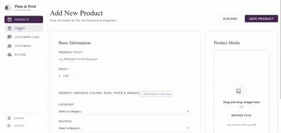

# 👕 Gazara  - E-Commerce Store

> A fully-featured e-commerce clothing store web application to browse products, manage shopping carts, handle dynamic sizes and colors, and track orders with a built-in admin dashboard, live chat, and return/exchange system.

---

## 🔗 Quick Links
* **Live Demo:** [View Live Demo](https://gazzra-e0f3c.web.app/)
* **Status:** In Progress

---

## 🎥 Project Demo



---

## 🛠️ Tech Stack
* **Frontend:** Angular, Standalone Components, TypeScript, RxJS
* **Styling & UI:** Bootstrap 5, Font Awesome, Custom CSS
* **Backend & Database:** Firebase (Cloud Firestore, Hosting)
* **Deployment:** Firebase Hosting

---

## ✨ Key Features
* **Product Catalog & Variants:** Browse clothing items with custom options for different sizes and colors.
* **Quick Cart Popup:** A floating cart drawer showing added items instantly at the bottom with a quick button to jump straight to the cart page.
* **Admin Dashboard:** A dedicated control panel for admins to add new products and manage incoming store orders.
* **Shipping Label & Invoice Printing:** A built-in feature for admins to print official order waybills containing customer details and order info.
* **Live Chat Support:** Real-time messaging system connecting customers directly with the store admin.
* **Return & Exchange System:** A dedicated lookup page where users enter their order ID and phone number to fetch their order and select specific items for return or exchange.

---

## 💡 Technical Challenges & Solutions
1. **Challenge 1 (Visitor Tracking Without User Login):**
   * *What happened:* Since users could browse and add items to the cart without registering right away, there was no auth token to track individual carts.
   * *How I fixed it:* Generated a unique **Visitor ID** saved directly in the browser's `localStorage` so I could easily separate users and keep track of their cart items independently.
2. **Challenge 2 (Handling Dynamic Sizes and Colors):**
   * *What happened:* Every clothing product came with multiple variations (different sizes and colors), which made saving and managing them a bit messy.
   * *How I fixed it:* Structured the product-adding form so that whenever a product is created, it dynamically generates inputs for its specific sizes and colors to store everything cleanly.
3. **Challenge 3 (Streamlining Returns & Exchanges):**
   * *What happened:* Needed an easy way for customers to request a return or exchange without bothering support through chat for every little thing.
   * *How I fixed it:* Built a lookup flow where users input their order ID and phone number, the system pulls up their specific order, and they can pick the exact item they want to return or exchange.

---

## ⚙️ Getting Started
To run this project locally:

1. **Clone the repository:**
   ```bash
   git clone [https://github.com/USERNAME/Gazara.git](https://github.com/USERNAME/Gazara.git)
